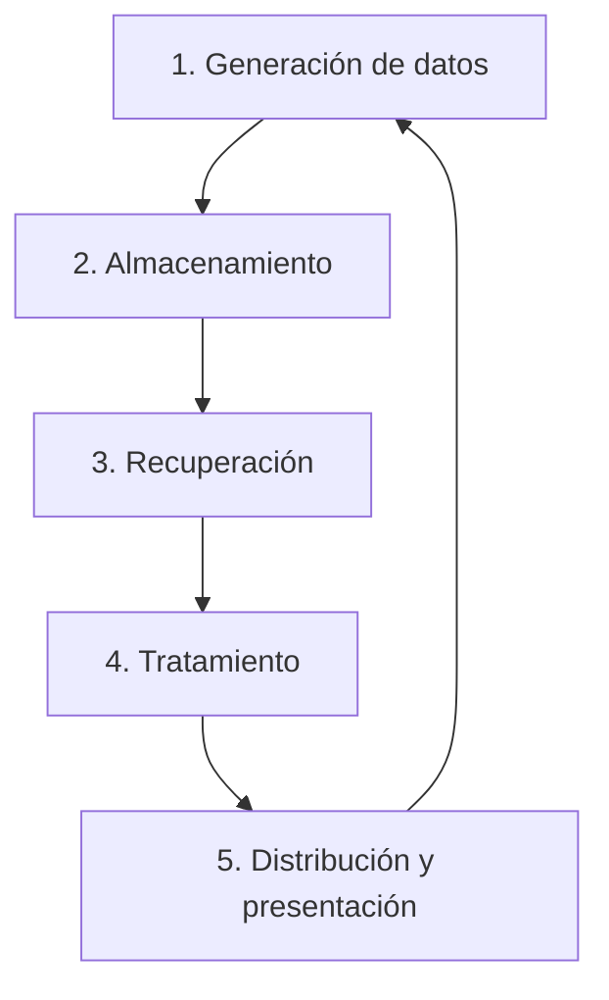

# Tema 1. Persistencia y gestión de la información

## 1.1. Los datos

### ¿Qué es un dato?
Un **dato** es una representación simbólica de un atributo, característica o valor que puede ser cuantificable o calificable.

**Ejemplos:**
- `25`: edad.
- `Verde`: color.
- `Alberto`: nombre.
- `192.168.1.1`: dirección IP.

Un dato aislado puede no proporcionar información útil porque necesita un **contexto**.

**Ejemplo:** el número `85` puede representar una temperatura, una edad o un porcentaje.

> [!important] Para el examen
> Los datos por sí solos no siempre ofrecen información valiosa. Adquieren significado cuando se contextualizan, estructuran, analizan e interpretan.

## 1.2. La información

### ¿Qué es la información?
La **información** es el resultado de organizar, relacionar e interpretar datos para que tengan significado y utilidad.

**Ejemplo:**
- Dato: `85`.
- Contexto: temperatura de una CPU.
- Información: la CPU está a 85 °C y podría necesitar una revisión.

### Diferencias entre datos e información

| Datos | Información |
|---|---|
| Valores o representaciones de hechos | Datos interpretados y contextualizados |
| Pueden estar aislados | Tienen significado |
| No siempre son útiles por sí solos | Permiten comprender situaciones y tomar decisiones |
| Ejemplo: 92 | Ejemplo: un equipo utiliza el 92 % de RAM |

### Obtención de información
Para obtener información es necesario:
1. **Recopilar:** recoger datos.
2. **Almacenar:** guardarlos para utilizarlos posteriormente.
3. **Organizar:** estructurarlos.
4. **Relacionar y analizar:** interpretarlos para obtener conclusiones.

### Persistencia de los datos
La **persistencia** es la capacidad de conservar datos para poder recuperarlos y utilizarlos posteriormente, incluso después de cerrar un programa o apagar el ordenador.

- **RAM:** memoria volátil. Su contenido se pierde al apagar el equipo.
- **SSD/HDD:** almacenamiento no volátil. Permite conservar datos tras apagar el equipo.

**Ejemplo:** una aplicación guarda los usuarios en una base de datos para que sigan existiendo cuando vuelva a ejecutarse.

> [!warning] Importante
> Persistencia no significa que los datos sean imposibles de perder. También son necesarias las copias de seguridad.

## 1.3. La gestión de los datos

### ¿Qué es la gestión de datos?
La **gestión de datos** es el conjunto de procesos necesarios para recopilar, almacenar, recuperar, tratar y distribuir datos de forma organizada y eficiente.

Su finalidad es permitir que los datos estén disponibles y puedan utilizarse cuando sea necesario.

### Ciclo de vida de los datos
Según el temario, comprende cinco fases:

1. **Generación:** creación o recopilación de datos.
2. **Almacenamiento:** conservación de los datos.
3. **Recuperación:** acceso a datos previamente guardados.
4. **Tratamiento:** procesamiento, análisis o modificación.
5. **Distribución y presentación:** comunicación o visualización de los resultados.



### Ejemplo práctico: gestión de incidencias IT

| Fase | Ejemplo |
|---|---|
| Generación | Un usuario comunica una incidencia |
| Almacenamiento | Se guarda el ticket |
| Recuperación | El técnico consulta el ticket |
| Tratamiento | Se modifica su estado a resuelto |
| Distribución y presentación | Se comunica la solución al usuario |

### Sistemas informáticos
Un **sistema informático** combina recursos para procesar y gestionar información.

Sus elementos principales son:
- **Hardware:** ordenadores, servidores y dispositivos de almacenamiento.
- **Software:** aplicaciones y programas.
- **Usuarios:** personas que utilizan o administran el sistema.
- **Procedimientos:** normas e instrucciones para gestionar los datos.

### Sistemas gestores de bases de datos
Un **SGBD** es un software que permite crear, almacenar, consultar, modificar y administrar bases de datos.

**Ejemplos:** MySQL, PostgreSQL y SQL Server.

## Resumen para el examen

| Concepto | Definición |
|---|---|
| Dato | Representación de un atributo o valor |
| Información | Datos contextualizados e interpretados |
| Persistencia | Conservación de datos para su uso posterior |
| Gestión de datos | Procesos para organizar y utilizar datos |
| Ciclo de vida | Generación, almacenamiento, recuperación, tratamiento y distribución/presentación |
| Sistema informático | Conjunto de recursos que gestionan información |
| SGBD | Software para administrar bases de datos |

> [!tip] Lo más importante
> - Diferenciar **dato** e **información**.
> - Comprender qué significa **persistencia**.
> - Memorizar las **cinco fases del ciclo de vida de los datos**.
> - Entender para qué sirve un **sistema informático**.

## Preguntas de repaso

1. ¿Qué es un dato?
2. ¿Qué diferencia existe entre un dato y la información?
3. ¿Por qué es importante contextualizar los datos?
4. ¿Qué significa persistencia?
5. ¿Qué diferencia existe entre la RAM y un SSD?
6. ¿Cuáles son las cinco fases del ciclo de vida de los datos?
7. ¿Qué es la gestión de datos?
8. ¿Qué elementos forman un sistema informático?
9. ¿Qué es un SGBD?

## Idea clave del tema

**Datos → Organización y análisis → Información útil**

Para que los datos puedan utilizarse a lo largo del tiempo, necesitamos almacenarlos de forma persistente y gestionarlos adecuadamente.

# 2. Sistemas de información. Ficheros

## 2.1. Sistemas de información

### ¿Qué es un sistema de información?

Un **sistema de información (SI)** es un conjunto de recursos que sirven para **recoger, almacenar, tratar y distribuir información** dentro de una organización.

Su objetivo es facilitar y optimizar la gestión de la información.

**Ejemplo:** una empresa utiliza un sistema de información para gestionar los datos de sus empleados, clientes, facturas y productos.

### Funcionamiento de un sistema de información

Un sistema de información realiza las siguientes operaciones:

1. **Entrada de datos:** se introduce información en el sistema.
    
2. **Tratamiento:** se procesan los datos para obtener resultados.
    
3. **Almacenamiento:** se guardan los datos para utilizarlos posteriormente.
    
4. **Recuperación:** se accede a datos previamente almacenados.
    
5. **Salida:** se presentan o distribuyen los resultados obtenidos.
    

**Ejemplo práctico: una tienda**

- **Entrada:** el empleado registra una venta.
    
- **Tratamiento:** el sistema calcula el importe total.
    
- **Almacenamiento:** se guarda la venta.
    
- **Recuperación:** se consulta una venta anterior.
    
- **Salida:** se genera un ticket o factura.
    

> [!IMPORTANT] Para el examen  
> Un sistema de información no tiene por qué utilizar ordenadores. Puede funcionar mediante procedimientos manuales, aunque la informática permite automatizar muchas de sus tareas.

---

## 2.2. Sistema informático

### ¿Qué es un sistema informático?

Un **sistema informático** es el conjunto de recursos tecnológicos que permiten realizar las operaciones de un sistema de información.

Se utiliza para automatizar la recopilación, almacenamiento, tratamiento y distribución de los datos.

### Componentes de un sistema informático

**1. Hardware**

Son los componentes físicos del sistema.

Ejemplos:

- CPU o procesador.
    
- Memoria RAM.
    
- Discos duros y SSD.
    
- Teclado y ratón.
    
- Monitor e impresora.
    
- Servidores y routers.
    

**2. Software**

Es el conjunto de programas y aplicaciones que permiten realizar las tareas del sistema.

Ejemplos:

- Sistemas operativos: Windows y Linux.
    
- Aplicaciones empresariales.
    
- Programas de gestión.
    
- Sistemas gestores de bases de datos, como MySQL.
    

**3. Peopleware**

Algunos autores incluyen una tercera categoría denominada **peopleware**, que hace referencia a las personas implicadas en el diseño, desarrollo, mantenimiento y utilización del sistema informático.

Ejemplos:

- Administradores de sistemas.
    
- Programadores.
    
- Técnicos informáticos.
    
- Usuarios.
    

### Relación entre componentes y funciones

|Función|Componentes|
|---|---|
|Entrada de datos|Teclado, escáner, lector de códigos|
|Tratamiento|CPU y memoria RAM|
|Almacenamiento|HDD, SSD y otros dispositivos|
|Salida de información|Monitor, impresora|

### Diferencia entre sistema de información y sistema informático

|Sistema de información|Sistema informático|
|---|---|
|Gestiona información dentro de una organización|Proporciona recursos tecnológicos|
|Incluye recursos, personas y procedimientos|Se basa principalmente en hardware y software|
|Puede funcionar manualmente|Utiliza tecnología informática|
|Ejemplo: gestión de pacientes de un hospital|Servidores y aplicaciones del hospital|

> [!TIP] Para recordar  
> **Sistema de información = gestión de la información.**
> 
> **Sistema informático = tecnología utilizada para automatizar esa gestión.**

---

## 2.3. Ficheros

### ¿Qué es un fichero?

Un **fichero o archivo** es un conjunto de datos almacenados en un dispositivo y organizados bajo un mismo nombre.

El sistema operativo permite crear, guardar, modificar, organizar y eliminar ficheros.

**Ejemplo:** `contactos.csv` es un fichero que almacena información sobre diferentes contactos.

### Estructura de un fichero

Un fichero de datos puede organizarse mediante tres elementos:

**1. Fichero**

Es el conjunto completo de datos almacenados.

Ejemplo: `contactos.csv`.

**2. Registro**

Es un conjunto de campos relacionados que representan un elemento concreto.

Ejemplo: todos los datos correspondientes a una persona.

**3. Campo o atributo**

Es cada uno de los datos o características que forman un registro.

Ejemplos: nombre, teléfono y correo electrónico.

### Ejemplo práctico

|Nombre|Teléfono|Correo electrónico|
|---|---|---|
|Ana|612345678|[ana@email.com](mailto:ana@email.com)|
|Luis|698765432|[luis@email.com](mailto:luis@email.com)|
|Marta|623456789|[marta@email.com](mailto:marta@email.com)|

- **Fichero:** toda la colección de contactos.
    
- **Registro:** cada fila de la tabla.
    
- **Campo:** cada columna, como nombre o teléfono.
    

> [!IMPORTANT] Para el examen  
> **Fichero = conjunto completo de registros.**
> 
> **Registro = conjunto de campos de un elemento.**
> 
> **Campo = atributo o característica de un registro.**
> 
> Esta equivalencia con una tabla sirve para comprender el ejemplo, aunque una tabla de una base de datos no tiene por qué corresponder a un único fichero físico.

### Tipos de ficheros según su formato

**1. Ficheros de texto plano**

Almacenan contenido que puede leerse mediante un editor de texto.

Ejemplo de `datos.txt`:

```
Nombre: Ana
Edad: 25
Ciudad: Madrid
```

Características:

- Son sencillos de crear y modificar.
    
- Pueden abrirse con editores de texto.
    
- No proporcionan por sí mismos funciones avanzadas para consultar o relacionar información.
    

**2. Ficheros estructurados**

Organizan los datos siguiendo un formato determinado.

Ejemplo de `clientes.csv`:

```
nombre,edad,ciudad
Ana,25,Madrid
Luis,30,Valencia
Marta,28,Sevilla
```

Características:

- Siguen una estructura definida.
    
- Facilitan la interpretación de los datos.
    
- Pueden ser procesados por aplicaciones.
    

Otros formatos estructurados son **JSON y XML**.

> [!NOTE] Importante  
> Un fichero puede ser de texto plano y estar estructurado al mismo tiempo. Por ejemplo, CSV, JSON y XML son formatos estructurados que normalmente se almacenan como texto.

### Formas de acceso a los ficheros

**Acceso secuencial**

Los datos se recorren siguiendo un orden.

Ejemplo: leer un archivo de texto línea por línea.

**Acceso directo**

Permite acceder a una posición concreta del fichero sin tener que recorrer necesariamente todo su contenido anterior.

Ejemplo: leer los datos almacenados en una posición determinada de un archivo.

|Acceso secuencial|Acceso directo|
|---|---|
|Recorre los datos en orden|Accede a posiciones concretas|
|Puede necesitar leer registros anteriores|Puede evitar recorrer todo el fichero|
|Ejemplo: lectura línea por línea|Ejemplo: lectura mediante desplazamiento o posición|

### ¿Qué es un sistema de gestión de ficheros (SGF)?

Un **sistema de gestión de ficheros (SGF)** es un conjunto de programas que, conjuntamente con el sistema operativo o formando parte de él, permiten **organizar, gestionar y recuperar información almacenada en memoria externa**.

### Funciones principales de un SGF

- Crear y eliminar ficheros.
    
- Leer y escribir datos.
    
- Organizar los archivos.
    
- Gestionar su ubicación en el almacenamiento.
    
- Recuperar información.
    
- Controlar el acceso a los ficheros.
    

El SGF recibe operaciones lógicas sobre los archivos y las transforma en operaciones de almacenamiento, trasladando los datos entre la memoria externa y la memoria interna cuando es necesario.

**Ejemplo:** cuando guardamos un documento, el sistema operativo utiliza mecanismos de gestión de ficheros para almacenarlo en el dispositivo correspondiente.

> [!WARNING] No confundir  
> **SGF:** sistema de gestión de ficheros. Administra archivos.
> 
> **SGBD:** sistema gestor de bases de datos. Administra bases de datos y permite realizar consultas y operaciones sobre sus datos.

---

## Resumen para el examen

|Concepto|Definición|
|---|---|
|Sistema de información (SI)|Recursos para recoger, guardar, tratar y distribuir información|
|Sistema informático|Recursos tecnológicos para automatizar la gestión de información|
|Hardware|Componentes físicos|
|Software|Programas y aplicaciones|
|Peopleware|Personas implicadas en el sistema|
|Fichero|Conjunto de datos almacenados|
|Registro|Conjunto de campos relacionados|
|Campo|Atributo o característica de un registro|
|Acceso secuencial|Lectura de datos siguiendo un orden|
|Acceso directo|Acceso a una posición concreta|
|SGF|Sistema de gestión de ficheros|

### Conceptos que debes memorizar

1. La definición de **sistema de información**.
    
2. La diferencia entre **sistema de información y sistema informático**.
    
3. Los componentes **hardware, software y peopleware**.
    
4. La diferencia entre **fichero, registro y campo**.
    
5. Las características de los **ficheros de texto plano y estructurados**.
    
6. Las diferencias entre **acceso secuencial y directo**.
    
7. La definición y funciones de un **SGF**.
    

---

## Preguntas de repaso

1. ¿Qué es un sistema de información?
    
2. ¿Qué operaciones realiza un sistema de información?
    
3. ¿Qué diferencia existe entre un sistema de información y uno informático?
    
4. ¿Qué es el hardware? Pon tres ejemplos.
    
5. ¿Qué es el software? Pon tres ejemplos.
    
6. ¿Qué significa peopleware?
    
7. ¿Qué es un fichero?
    
8. ¿Qué diferencia existe entre un registro y un campo?
    
9. ¿Qué diferencia existe entre un fichero de texto plano y uno estructurado?
    
10. ¿Qué diferencia existe entre acceso secuencial y directo?
    
11. ¿Qué es un sistema de gestión de ficheros?
    
12. ¿Qué diferencia existe entre SGF y SGBD?
    

---

## Idea clave del apartado

Un **sistema de información** permite gestionar la información de una organización. Cuando se utilizan recursos tecnológicos para automatizar sus operaciones, interviene un **sistema informático**.

Los datos pueden almacenarse en **ficheros**, que pueden organizarse en **registros y campos**.

Los **sistemas de gestión de ficheros** permiten administrar y recuperar estos archivos de manera organizada.

# 3. Bases de datos: topologías y arquitecturas

## ¿Qué es una base de datos?

Una **base de datos (BD)** es un conjunto organizado de datos relacionados entre sí, almacenados para facilitar su consulta, modificación y gestión.

A diferencia de un conjunto de ficheros independientes, una base de datos permite establecer y gestionar **relaciones entre los datos**.

**Ejemplo:** una academia necesita almacenar los alumnos y sus notas.

**Tabla ALUMNOS**

|NIA|Nombre|
|---|---|
|123456|Jorge González|
|135736|Almudena Pérez|
|148993|Estrella López|

**Tabla NOTAS**

|NIA|Módulo|Nota|
|---|---|---|
|123456|GBD|10|
|135736|GBD|9|
|148993|GBD|10|

Las tablas están relacionadas mediante el campo **NIA (Número de Identificación del Alumno)**.

Gracias a esta relación podemos conocer las notas de cada alumno sin repetir su nombre en la tabla de notas.

---

## 3.1. Características fundamentales de las bases de datos

Las bases de datos presentan cuatro características fundamentales:

### 1. Integridad de la información

La **integridad** garantiza que los datos almacenados respeten las reglas establecidas y mantengan su coherencia.

**Ejemplo:**

En una base de datos de alumnos y notas, podemos establecer una regla que impida registrar una nota de un alumno que no existe.

- **Correcto:** alumno 123456 → nota 9. El alumno existe.
    
- **Incorrecto:** alumno 999999 → nota 8. El alumno no existe.
    

En las bases de datos relacionales, estas reglas pueden aplicarse mediante restricciones como las **claves foráneas**.

> [!IMPORTANT] Para el examen  
> La integridad de la información busca garantizar que los datos sean válidos y coherentes y que se respeten las relaciones establecidas.

### 2. Minimización de redundancias

La **redundancia** consiste en almacenar repetidamente un mismo dato.

Las bases de datos permiten reducir la duplicación innecesaria de información.

**Ejemplo con redundancia:**

|Alumno|Módulo|Nota|
|---|---|---|
|Jorge González|GBD|10|
|Jorge González|Redes|8|
|Jorge González|Sistemas|9|

El nombre del alumno aparece repetido.

**Ejemplo minimizando la redundancia:**

Tabla ALUMNOS:

|NIA|Nombre|
|---|---|
|123456|Jorge González|

Tabla NOTAS:

|NIA|Módulo|Nota|
|---|---|---|
|123456|GBD|10|
|123456|Redes|8|
|123456|Sistemas|9|

El nombre se almacena una sola vez y se relaciona con las notas mediante el NIA.

**Ventajas:**

- Se reduce la duplicación de información.
    
- Se facilita la actualización de los datos.
    
- Se disminuye el riesgo de inconsistencias.
    
- Puede reducirse el espacio de almacenamiento.
    

> [!NOTE]  
> Minimizar la redundancia no significa eliminar toda repetición. Los identificadores utilizados para relacionar tablas pueden aparecer varias veces.

### 3. Facilitan la compartición

Las bases de datos permiten que **varios usuarios o aplicaciones trabajen con la misma información**.

Además, pueden establecerse permisos para controlar quién puede consultar, modificar o eliminar datos.

**Ejemplo: un hospital**

- Recepción registra los datos de los pacientes.
    
- Los médicos consultan los historiales.
    
- Administración gestiona las facturas.
    

Todos trabajan sobre información compartida, pero con diferentes permisos.

**Ventajas:**

- Acceso compartido a la información.
    
- Control de usuarios y permisos.
    
- Menor necesidad de mantener copias independientes.
    
- Mejor coordinación entre departamentos.
    

### 4. Independencia de las aplicaciones de usuario

Una misma base de datos puede utilizarse desde diferentes aplicaciones, incluso si están desarrolladas en distintos lenguajes de programación o funcionan en distintos sistemas operativos.

**Ejemplo:**

Una base de datos MySQL puede ser utilizada por:

- Una aplicación web desarrollada con React y Node.js.
    
- Una aplicación de escritorio desarrollada con C#.
    
- Una aplicación móvil.
    

Todas pueden acceder a los mismos datos mediante conexiones o servicios adecuados.

La independencia también permite separar, en cierta medida, la organización lógica de los datos de su almacenamiento físico.

> [!TIP] Resumen de las cuatro características
> 
> - **Integridad:** datos válidos y coherentes.
>     
> - **Redundancia mínima:** evitar duplicaciones innecesarias.
>     
> - **Compartición:** varios usuarios pueden utilizar los mismos datos.
>     
> - **Independencia:** distintas aplicaciones pueden trabajar con la misma base de datos.
>     

---

## 3.2. Arquitectura de una base de datos

La **arquitectura de una base de datos** describe cómo se organizan, almacenan y gestionan sus datos y componentes.

Según el temario, podemos distinguir dos niveles fundamentales.

### Nivel físico

El **nivel físico** describe cómo y dónde se almacenan realmente los datos.

Incluye:

- Archivos de almacenamiento.
    
- Discos HDD y SSD.
    
- Estructuras físicas de almacenamiento.
    
- Métodos de acceso a los datos.
    

**Ejemplo:** una base de datos MySQL almacena información en archivos situados en el SSD de un servidor.

### Nivel lógico

El **nivel lógico** describe cómo se organizan y relacionan los datos, independientemente de los detalles físicos de almacenamiento.

Incluye:

- Tablas.
    
- Campos o atributos.
    
- Relaciones.
    
- Restricciones.
    

**Ejemplo:** una tabla ALUMNOS está relacionada con una tabla NOTAS mediante el campo NIA.

### Diferencias entre nivel físico y lógico

|Nivel físico|Nivel lógico|
|---|---|
|Cómo y dónde se almacenan los datos|Cómo se organizan y relacionan|
|Archivos, discos y estructuras de almacenamiento|Tablas, campos y relaciones|
|Se centra en el almacenamiento|Se centra en la estructura de la información|

> [!IMPORTANT] Para el examen  
> **Nivel físico = almacenamiento real de los datos.**
> 
> **Nivel lógico = organización y relaciones entre los datos.**

---

## Tipos de bases de datos según su ubicación

### 1. Base de datos centralizada

Una **base de datos centralizada** almacena y gestiona la información en un sistema central, al que pueden acceder distintos usuarios o equipos.

**Ejemplo:** una empresa almacena su base de datos en un servidor central y todos los empleados se conectan a él.

**Ventajas:**

- Administración más sencilla.
    
- Control centralizado de los datos.
    
- Mayor facilidad para gestionar los permisos.
    
- No es necesario mantener múltiples copias independientes.
    

**Inconvenientes:**

- Puede existir un punto único de fallo.
    
- El servidor puede convertirse en un cuello de botella.
    
- La capacidad de crecimiento puede estar limitada por los recursos del servidor.
    

> [!NOTE]  
> Una base de datos centralizada puede utilizar almacenamiento NAS o RAID. Esto no significa necesariamente que sea distribuida.

### 2. Base de datos distribuida

Una **base de datos distribuida** almacena información en varios ordenadores o nodos conectados entre sí, que trabajan de forma coordinada.

**Ejemplo:** una empresa internacional utiliza servidores situados en Madrid, París y Berlín para distribuir su información.

**Ventajas:**

- Puede mejorar la disponibilidad.
    
- Facilita la ampliación del sistema.
    
- Permite repartir el almacenamiento y la carga de trabajo.
    
- Puede acercar los datos a los usuarios.
    

**Inconvenientes:**

- Administración más compleja.
    
- Necesidad de coordinación entre nodos.
    
- Posibles problemas de sincronización.
    
- Mayor complejidad para mantener la consistencia de los datos.
    

### Diferencias entre bases de datos centralizadas y distribuidas

|Centralizada|Distribuida|
|---|---|
|Sistema central|Varios nodos|
|Administración más sencilla|Administración más compleja|
|Posible punto único de fallo|Puede ofrecer mayor tolerancia a fallos|
|Recursos concentrados|Recursos repartidos|
|Crecimiento condicionado por el sistema central|Puede ampliarse añadiendo nodos|

---

## Formas de distribución de los datos

Las bases de datos distribuidas pueden organizarse de tres maneras principales.

### 1. Replicación

La **replicación** consiste en mantener copias de los mismos datos en distintos nodos.

**Ejemplo:**

- Nodo A: alumnos 1, 2 y 3.
    
- Nodo B: alumnos 1, 2 y 3.
    
- Nodo C: alumnos 1, 2 y 3.
    

Los tres nodos contienen copias de los mismos datos.

**Ventajas:**

- Mayor disponibilidad si las réplicas están operativas.
    
- Posibilidad de recuperar información desde otros nodos.
    
- Puede mejorar el rendimiento de determinadas consultas.
    

**Inconvenientes:**

- Mayor consumo de almacenamiento.
    
- Coste de mantenimiento y sincronización.
    
- Posibles inconsistencias temporales entre copias.
    

### 2. Partición

La **partición** consiste en dividir los datos entre diferentes nodos, sin duplicar necesariamente toda la información.

**Ejemplo:**

- Nodo A: alumnos 1, 2 y 3.
    
- Nodo B: alumnos 4, 5 y 6.
    
- Nodo C: alumnos 7, 8 y 9.
    

Cada nodo almacena una parte diferente de los datos.

**Ventajas:**

- Reparte la carga de trabajo.
    
- Reduce la cantidad de datos almacenados por nodo.
    
- Facilita el crecimiento del sistema.
    

**Inconvenientes:**

- Puede complicar las consultas que necesitan datos de varios nodos.
    
- Si falla un nodo sin réplica, sus datos pueden quedar inaccesibles.
    
- Requiere gestionar la distribución de las particiones.
    

### 3. Combinación de replicación y partición

Consiste en **dividir los datos en particiones y mantener copias de algunas o todas ellas**.

**Ejemplo:**

- Nodo A: alumnos 1, 2 y 3.
    
- Nodo B: copia de los alumnos 1, 2 y 3.
    
- Nodo C: alumnos 4, 5 y 6.
    
- Nodo D: copia de los alumnos 4, 5 y 6.
    

Así se combina el reparto de datos con la existencia de copias de seguridad operativas o réplicas.

**Ventajas:**

- Mayor tolerancia a fallos.
    
- Reparto de carga.
    
- Mejor capacidad de crecimiento.
    

**Inconvenientes:**

- Mayor complejidad de administración.
    
- Necesidad de sincronización.
    
- Mayor consumo de recursos que la partición sin réplicas.
    

### Comparación de los métodos de distribución

|Método|Funcionamiento|Principal ventaja|
|---|---|---|
|Replicación|Copias de los mismos datos|Disponibilidad|
|Partición|Datos divididos entre nodos|Reparto de carga y almacenamiento|
|Combinado|Particiones con réplicas|Escalabilidad y tolerancia a fallos|

> [!IMPORTANT] Para el examen  
> **Replicación = copiar datos.**
> 
> **Partición = dividir datos.**
> 
> **Combinación = dividir y copiar datos.**

---

## Resumen para el examen

|Concepto|Definición|
|---|---|
|Base de datos|Conjunto organizado de datos relacionados|
|Integridad|Garantizar datos válidos y coherentes|
|Redundancia|Repetición de información|
|Compartición|Acceso a datos por varios usuarios o aplicaciones|
|Independencia|Uso de los datos desde diferentes aplicaciones|
|Nivel físico|Almacenamiento real de los datos|
|Nivel lógico|Organización y relaciones entre los datos|
|BD centralizada|Información gestionada en un sistema central|
|BD distribuida|Información almacenada en varios nodos|
|Replicación|Mantener copias de datos|
|Partición|Dividir datos entre nodos|
|Método combinado|Combinar partición y replicación|

### Conceptos que debes memorizar

1. La definición de **base de datos**.
    
2. Las cuatro características fundamentales.
    
3. Las diferencias entre **nivel físico y lógico**.
    
4. Las diferencias entre **base de datos centralizada y distribuida**.
    
5. Qué es la **replicación**.
    
6. Qué es la **partición**.
    
7. Cómo funciona la **combinación de replicación y partición**.
    

---

## Preguntas de repaso

1. ¿Qué es una base de datos?
    
2. ¿Qué diferencia existe entre una base de datos y un conjunto de ficheros independientes?
    
3. ¿Qué significa integridad de la información?
    
4. ¿Qué es la redundancia?
    
5. ¿Por qué es importante minimizar las redundancias?
    
6. ¿Qué significa que una base de datos facilite la compartición?
    
7. ¿Qué es la independencia de las aplicaciones?
    
8. ¿Qué diferencia existe entre nivel físico y nivel lógico?
    
9. ¿Qué es una base de datos centralizada?
    
10. ¿Qué es una base de datos distribuida?
    
11. ¿Cuáles son las ventajas y desventajas de una base de datos distribuida?
    
12. ¿Qué diferencia existe entre replicación y partición?
    
13. ¿En qué consiste combinar replicación y partición?
    

---

## Idea clave del apartado

Las **bases de datos** permiten organizar información relacionada, mantener su integridad, reducir redundancias y compartir datos entre distintas aplicaciones.

Su arquitectura determina cómo se organizan y almacenan los datos.

Según su ubicación, pueden ser **centralizadas o distribuidas**.

Las bases de datos distribuidas pueden utilizar **replicación, partición o una combinación de ambas** para mejorar la disponibilidad, repartir la carga y facilitar el crecimiento del sistema.

# 4. Sistemas gestores de bases de datos (SGBD)

## ¿Qué es un SGBD?

Un **Sistema Gestor de Bases de Datos (SGBD)** es un conjunto de programas y herramientas que permiten **crear, almacenar, consultar, modificar y administrar bases de datos**.

También se encarga de controlar el acceso a los datos, mantener su integridad y facilitar su recuperación ante determinados fallos.

**Ejemplos de SGBD:**

- MySQL.
    
- PostgreSQL.
    
- Microsoft SQL Server.
    
- Oracle Database.
    
- SQLite.
    

### Diferencia entre base de datos y SGBD

|Base de datos|SGBD|
|---|---|
|Conjunto organizado de datos relacionados|Software que administra bases de datos|
|Contiene la información|Permite gestionar la información|
|Ejemplo: base de datos de clientes|Ejemplo: MySQL|

**Ejemplo práctico:**

Una aplicación desarrollada en C# necesita almacenar los datos de sus usuarios.

1. La aplicación solicita guardar un usuario.
    
2. El SGBD recibe y procesa la operación.
    
3. Los datos se almacenan en la base de datos.
    
4. La aplicación puede consultarlos posteriormente.
    

> [!IMPORTANT] Para el examen  
> **Base de datos = conjunto organizado de datos.**
> 
> **SGBD = software que permite gestionar esos datos.**

---

## 4.1. Características fundamentales de los SGBD

Un sistema gestor de bases de datos debe cumplir las siguientes funciones:

### 1. Gestión de datos y relaciones

Un SGBD debe permitir administrar tanto los datos como las relaciones existentes entre ellos.

**Ejemplo:** relacionar una tabla de clientes con otra de pedidos mediante el identificador del cliente.

### 2. Creación y modificación de estructuras

Permite crear, modificar y ampliar las estructuras de una base de datos.

**Ejemplos:**

- Crear una tabla.
    
- Añadir una columna.
    
- Modificar un tipo de dato.
    
- Eliminar una tabla.
    
- Establecer relaciones.
    

### 3. Gestión de usuarios y permisos

Permite administrar los usuarios que acceden a la base de datos y las operaciones que pueden realizar.

|Usuario|Permisos|
|---|---|
|Administrador|Gestión completa|
|Empleado|Consultar y modificar determinados datos|
|Invitado|Solo lectura|

**Objetivo:** evitar accesos no autorizados y proteger la información.

### 4. Herramientas de administración

Los SGBD proporcionan interfaces y herramientas que facilitan las tareas de administración.

Pueden utilizarse mediante:

- Interfaces gráficas.
    
- Terminales de comandos.
    
- Herramientas de administración.
    
- Conexiones desde aplicaciones.
    

**Ejemplo:** MySQL Workbench permite administrar servidores MySQL mediante una interfaz gráfica.

### 5. Acceso concurrente

La **concurrencia** permite que varios usuarios o aplicaciones accedan a una base de datos al mismo tiempo.

El SGBD debe coordinar las operaciones simultáneas para mantener la coherencia de la información.

**Ejemplo:**

Dos clientes intentan comprar la última unidad de un producto.

El SGBD debe coordinar las operaciones para evitar que ambos pedidos descuenten incorrectamente la misma unidad disponible.

Para ello puede utilizar:

- Transacciones.
    
- Bloqueos.
    
- Mecanismos de control de concurrencia.
    

### 6. Independencia de las aplicaciones

Una misma base de datos puede utilizarse desde diferentes aplicaciones, lenguajes de programación y sistemas operativos.

**Ejemplo:**

Una base de datos MySQL puede ser utilizada por:

- Una aplicación en C#.
    
- Una página web con Node.js.
    
- Una aplicación móvil.
    

### Mecanismos fundamentales de un SGBD

|Mecanismo|Función|
|---|---|
|Minimización de redundancias|Reducir duplicaciones innecesarias|
|Control de restricciones|Mantener la validez e integridad de los datos|
|Recuperación de datos|Recuperarse de determinadas operaciones fallidas|
|Control de concurrencia|Coordinar accesos simultáneos|
|Gestión de usuarios|Administrar cuentas, roles y permisos|

> [!NOTE]  
> Los mecanismos de recuperación de un SGBD no sustituyen las copias de seguridad.

---

## 4.2. Correspondencia entre SGF y SGBD

En los sistemas de gestión de ficheros (SGF) y en las bases de datos relacionales se utilizan conceptos similares, pero con diferentes nombres.

### Tabla de equivalencias

|Sistema de gestión de ficheros (SGF)|Base de datos relacional (SGBD)|
|---|---|
|Fichero|Tabla o entidad|
|Registro|Fila o tupla|
|Campo|Atributo o columna|
|Tipo de dato|Dominio|

### Conceptos fundamentales

**1. Tabla**

Estructura que organiza los datos en filas y columnas.

**2. Fila o tupla**

Representa un registro concreto dentro de una tabla.

**3. Atributo**

Es una característica de los elementos almacenados en una tabla. Se representa mediante una columna.

**4. Dominio**

Es el conjunto de valores permitidos para un atributo.

### Ejemplo práctico

**Tabla ALUMNOS**

|ID|Nombre|Edad|
|---|---|---|
|1|Ana|22|
|2|Luis|25|
|3|Marta|21|

- **Tabla:** ALUMNOS.
    
- **Tupla:** cada fila correspondiente a un alumno.
    
- **Atributos:** ID, Nombre y Edad.
    
- **Dominio:** para Edad podríamos permitir números enteros entre 0 y 120.
    
- **Valor:** el dato concreto almacenado en una celda, por ejemplo, `22`.
    

### ¿Qué son las restricciones?

Las **restricciones** son reglas que deben cumplir los datos almacenados.

**Ejemplos:**

- El identificador de un alumno debe ser único.
    
- El nombre no puede estar vacío.
    
- La edad no puede ser negativa.
    
- Una nota debe estar comprendida entre 0 y 10.
    

Las restricciones permiten mantener la **integridad de los datos**.

> [!IMPORTANT] Para el examen
> 
> - **Fichero → Tabla.**
>     
> - **Registro → Fila o tupla.**
>     
> - **Campo → Atributo.**
>     
> - **Tipo de dato → Dominio.**
>     
> 
> Son equivalencias conceptuales utilizadas en el temario. Un dominio puede incluir más restricciones que un simple tipo de dato.

---

## 4.3. Componentes de los sistemas gestores de bases de datos

Los SGBD se componen principalmente de cinco elementos.

### 1. Gestor o motor de la base de datos

Es el componente encargado de ejecutar las operaciones necesarias para administrar los datos.

**Funciones:**

- Almacenar información.
    
- Ejecutar consultas.
    
- Insertar y modificar registros.
    
- Eliminar datos.
    
- Gestionar transacciones.
    
- Coordinar operaciones de acceso.
    

**Ejemplo:** el motor de almacenamiento InnoDB utilizado por MySQL.

### 2. Diccionario de datos

El **diccionario de datos** almacena información sobre cómo está organizada la base de datos.

Esta información se denomina **metadatos**, es decir, datos que describen otros datos.

**Puede contener:**

- Nombres de tablas.
    
- Nombres de columnas.
    
- Tipos de datos.
    
- Relaciones.
    
- Restricciones.
    
- Información sobre índices y otros objetos.
    

**Ejemplo:**

El diccionario puede indicar que la tabla ALUMNOS contiene una columna `edad` de tipo entero.

> [!TIP] Para recordar  
> **Diccionario de datos = información sobre la estructura de la base de datos.**

### 3. Usuarios

Son las personas o cuentas que utilizan o administran el sistema gestor de bases de datos.

**Ejemplos:**

- Administradores de bases de datos (DBA).
    
- Desarrolladores.
    
- Usuarios de aplicaciones.
    
- Cuentas de servicio.
    

Cada usuario puede tener distintos roles y permisos.

### 4. Lenguajes

Los SGBD proporcionan lenguajes para crear estructuras y trabajar con los datos.

En los sistemas gestores de bases de datos relacionales se utiliza principalmente **SQL (Structured Query Language)**.

**Ejemplos de operaciones SQL:**

Crear una tabla:

```
CREATE TABLE alumnos (
    id INT PRIMARY KEY,
    nombre VARCHAR(100)
);
```

Consultar datos:

```
SELECT * FROM alumnos;
```

Insertar un registro:

```
INSERT INTO alumnos (id, nombre)
VALUES (1, 'Ana');
```

### 5. Interfaces externas

Permiten que los usuarios y aplicaciones interactúen con el SGBD.

**Ejemplos:**

- Interfaces gráficas.
    
- Terminales.
    
- Herramientas de administración.
    
- Controladores y conexiones desde aplicaciones.
    

---

## Arquitectura de tres niveles de un SGBD

La arquitectura de un SGBD describe cómo se organiza y presenta la información.

Según el temario, se divide en tres niveles:

1. Nivel interno.
    
2. Nivel conceptual.
    
3. Nivel externo.
    

### 1. Nivel interno

El **nivel interno** describe cómo se almacenan físicamente los datos y cómo se accede a ellos.

Incluye:

- Archivos.
    
- Estructuras físicas.
    
- Índices.
    
- Métodos de almacenamiento.
    

**Ejemplo:** los archivos y estructuras que utiliza MySQL para almacenar una tabla en un SSD.

El usuario normalmente no necesita conocer estos detalles.

### 2. Nivel conceptual

El **nivel conceptual** describe la organización lógica global de la base de datos.

Incluye:

- Tablas.
    
- Atributos.
    
- Relaciones.
    
- Restricciones.
    
- Estructura general de la información.
    

**Ejemplo:**

Una base de datos de una tienda contiene las tablas:

- CLIENTES.
    
- PRODUCTOS.
    
- PEDIDOS.
    

Estas tablas están relacionadas entre sí.

### 3. Nivel externo

El **nivel externo** representa las diferentes vistas de la información que utilizan los usuarios o aplicaciones.

Cada usuario puede acceder a una parte de la base de datos según sus necesidades y permisos.

**Ejemplo: una empresa**

- Departamento de ventas: consulta clientes y pedidos.
    
- Almacén: consulta productos y existencias.
    
- Administración: consulta información de facturación.
    

Cada departamento puede disponer de una vista diferente de los mismos datos.

### Esquema de la arquitectura

```
flowchart TD
    A["Usuarios y aplicaciones"] --> B["Nivel externo"]
    B --> C["Nivel conceptual"]
    C --> D["Nivel interno"]
    D --> E[("Base de datos")]
```

### Diferencias entre los tres niveles

|Nivel|Función|Ejemplo|
|---|---|---|
|Externo|Presentar vistas de los datos|Vista de pedidos|
|Conceptual|Definir la estructura lógica global|Tablas y relaciones|
|Interno|Organizar el almacenamiento físico|Archivos e índices|

> [!IMPORTANT] Para el examen  
> **Nivel externo = lo que ve cada usuario.**
> 
> **Nivel conceptual = cómo están organizados los datos.**
> 
> **Nivel interno = cómo se almacenan físicamente.**

### ¿Por qué se utilizan tres niveles?

Esta separación permite:

- Ocultar los detalles físicos a los usuarios.
    
- Ofrecer diferentes vistas de la información.
    
- Facilitar la administración.
    
- Mejorar la independencia entre los datos y las aplicaciones.
    
- Realizar ciertos cambios en la estructura o almacenamiento sin modificar necesariamente todas las aplicaciones.
    

---

## Resumen para el examen

|Concepto|Definición|
|---|---|
|SGBD|Software para crear y administrar bases de datos|
|Concurrencia|Acceso simultáneo y coordinado de varios usuarios|
|Integridad|Mantenimiento de datos válidos y coherentes|
|Restricción|Regla que deben cumplir los datos|
|Tabla|Estructura formada por filas y columnas|
|Tupla|Fila o registro de una tabla|
|Atributo|Columna o característica|
|Dominio|Conjunto de valores permitidos|
|Motor|Componente que ejecuta operaciones sobre los datos|
|Diccionario de datos|Información sobre la estructura de la base de datos|
|Metadatos|Datos que describen otros datos|
|SQL|Lenguaje utilizado en bases de datos relacionales|
|Nivel externo|Vistas de los usuarios|
|Nivel conceptual|Estructura lógica global|
|Nivel interno|Almacenamiento físico|

### Conceptos que debes memorizar

1. La definición de **SGBD**.
    
2. Las características fundamentales de los SGBD.
    
3. Los mecanismos de control de redundancias, restricciones, recuperación, concurrencia y permisos.
    
4. Las equivalencias entre **SGF y SGBD**.
    
5. Los cinco componentes principales de un SGBD.
    
6. Qué es el **diccionario de datos**.
    
7. Las diferencias entre los **niveles interno, conceptual y externo**.
    

---

## Preguntas de repaso

1. ¿Qué es un SGBD?
    
2. ¿Qué diferencia existe entre una base de datos y un SGBD?
    
3. ¿Qué significa acceso concurrente?
    
4. ¿Qué mecanismos utiliza un SGBD para mantener la integridad?
    
5. ¿Qué funciones cumple la gestión de usuarios?
    
6. ¿Cómo se denomina un registro en una base de datos relacional?
    
7. ¿Qué es un atributo?
    
8. ¿Qué es un dominio?
    
9. ¿Qué es el diccionario de datos?
    
10. ¿Cuáles son los cinco componentes de un SGBD?
    
11. ¿Qué es SQL?
    
12. ¿Qué representa el nivel interno?
    
13. ¿Qué representa el nivel conceptual?
    
14. ¿Qué representa el nivel externo?
    
15. ¿Qué ventajas proporciona la arquitectura de tres niveles?
    

---

## Idea clave del apartado

Un **SGBD** es el software encargado de gestionar las bases de datos, controlar los accesos, mantener la integridad y facilitar las operaciones sobre la información.

En las bases de datos relacionales, los datos se organizan mediante **tablas, filas, atributos y dominios**.

Los SGBD incluyen componentes como el **motor, el diccionario de datos, los usuarios, los lenguajes y las interfaces externas**.

# 5. Modelos de bases de datos

## ¿Qué es un modelo de base de datos?

Un **modelo de base de datos** es una forma de representar y organizar los datos, sus características y las relaciones existentes entre ellos.

Los modelos permiten definir cómo se estructurará la información dentro de una base de datos.

**Ejemplo:**

Una academia necesita almacenar información sobre:

- Alumnos.
    
- Profesores.
    
- Asignaturas.
    
- Matrículas.
    
- Notas.
    

Antes de crear la base de datos, debemos decidir qué datos almacenaremos y cómo estarán relacionados.

Para ello utilizamos un **modelo de datos**.

---

## 5.1. El modelo lógico

### ¿Qué es un modelo lógico?

Un **modelo lógico** describe cómo se organizan los datos y sus relaciones, sin entrar en los detalles de su almacenamiento físico.

Se centra en:

- La estructura de los datos.
    
- Sus características.
    
- Las relaciones entre ellos.
    
- Las restricciones que deben cumplir.
    

El modelo lógico sirve como guía para diseñar e implementar una base de datos.

### Modelos y herramientas de representación

**1. Modelo entidad-relación (E/R)**

Permite representar los elementos de una base de datos mediante:

- **Entidades:** objetos o conceptos sobre los que queremos almacenar información.
    
- **Atributos:** características de las entidades.
    
- **Relaciones:** asociaciones entre entidades.
    

**Ejemplo:**

Una academia tiene alumnos que se matriculan en asignaturas.

- Entidad: ALUMNO.
    
- Entidad: ASIGNATURA.
    
- Relación: MATRÍCULA.
    

**2. Lenguaje Unificado de Modelado (UML)**

UML (_Unified Modeling Language_) es un lenguaje gráfico que permite representar diferentes aspectos de un sistema informático.

Se utiliza principalmente en el análisis y diseño de software, aunque también puede emplearse para representar estructuras de datos.

> [!NOTE]  
> Aunque el temario presenta E/R y UML dentro del apartado de modelos lógicos, el modelo entidad-relación se utiliza habitualmente durante el **diseño conceptual** de bases de datos.

> [!IMPORTANT] Para el examen  
> **Modelo lógico = organización, relaciones y restricciones de los datos, sin detallar su almacenamiento físico.**

---

## 5.2. El modelo conceptual/físico

El temario utiliza el término **modelo conceptual/físico** para explicar las estructuras concretas con las que se representan y organizan los datos.

En el diseño de bases de datos es habitual distinguir tres niveles.

### 1. Modelo conceptual

Describe **qué información necesitamos almacenar y cómo se relaciona**, sin depender de un SGBD concreto.

**Ejemplo:**

Un alumno puede matricularse en varias asignaturas.

En esta fase identificamos las entidades y relaciones necesarias.

### 2. Modelo lógico

Transforma el diseño conceptual en una estructura de datos organizada según un modelo determinado.

**Ejemplo:**

Crear las estructuras lógicas:

- ALUMNOS.
    
- ASIGNATURAS.
    
- MATRÍCULAS.
    

Estableciendo las relaciones entre ellas.

### 3. Modelo físico

Describe **cómo se implementan y almacenan realmente los datos** en un sistema gestor de bases de datos.

Incluye:

- Archivos.
    
- Índices.
    
- Estructuras de almacenamiento.
    
- Organización física de los datos.
    

**Ejemplo:** almacenar las tablas de una academia mediante MySQL en un servidor con SSD.

### Diferencias entre los modelos

|Modelo|¿Qué describe?|Ejemplo|
|---|---|---|
|Conceptual|Qué datos existen y cómo se relacionan|Alumno se matricula en asignatura|
|Lógico|Cómo se estructuran los datos|Tablas y relaciones|
|Físico|Cómo se implementan y almacenan|Archivos e índices|

> [!TIP] Para recordar  
> **Conceptual = qué información necesitamos.**
> 
> **Lógico = cómo organizamos esa información.**
> 
> **Físico = cómo se almacena e implementa.**

---

## 5.3. Evolución de los sistemas gestores de bases de datos

Los sistemas gestores de bases de datos han evolucionado para adaptarse a las necesidades de almacenamiento, consulta y tratamiento de la información.

### Década de 1960: modelos navegacionales

Aparecieron los primeros sistemas de bases de datos basados en estructuras jerárquicas y en red.

Los programas debían recorrer relaciones y referencias entre registros para localizar la información.

**Características:**

- Acceso navegacional.
    
- Relaciones mediante referencias entre registros.
    
- Estructuras jerárquicas o de red.
    

**Ejemplos históricos:**

- IMS de IBM.
    
- Sistemas basados en CODASYL.
    

### Década de 1970: modelo relacional

En 1970, **Edgar F. Codd**, investigador de IBM, propuso el modelo relacional.

Este modelo representa los datos mediante relaciones, que habitualmente visualizamos como tablas.

**Características:**

- Datos organizados en tablas.
    
- Filas y columnas.
    
- Relaciones entre tablas.
    
- Consultas declarativas mediante lenguajes como SQL.
    

SQL se desarrolló posteriormente y se convirtió en el lenguaje más utilizado para trabajar con bases de datos relacionales.

**Ejemplos de SGBD relacionales:**

- MySQL.
    
- PostgreSQL.
    
- Oracle Database.
    
- Microsoft SQL Server.
    
- MariaDB.
    

> [!IMPORTANT]  
> **Edgar F. Codd es considerado el creador del modelo relacional de bases de datos.**

### Décadas de 1980 y 1990: bases de datos orientadas a objetos

Con el crecimiento de la programación orientada a objetos, aparecieron sistemas que permitían almacenar objetos complejos.

Un objeto puede contener:

- Atributos.
    
- Relaciones con otros objetos.
    
- Comportamientos o métodos.
    

**Ejemplo:**

Un objeto ALUMNO puede tener:

- Nombre.
    
- Edad.
    
- Curso.
    
- Operaciones relacionadas con su comportamiento.
    

También aparecieron sistemas **objeto-relacionales**, que incorporan características de los objetos al modelo relacional.

### Década de 2000 en adelante: NoSQL

Las bases de datos **NoSQL** adquirieron popularidad por la necesidad de gestionar grandes volúmenes de información, estructuras flexibles y sistemas distribuidos.

NoSQL agrupa diferentes modelos que no siguen necesariamente el modelo relacional tradicional.

**Principales categorías:**

- Documentales.
    
- Clave-valor.
    
- Orientadas a columnas o familias de columnas.
    
- Grafos.
    

**Ejemplos:**

- MongoDB.
    
- Redis.
    
- Apache Cassandra.
    
- Neo4j.
    

### Ejemplo de documento en MongoDB

```
{
  "nombre": "Ana",
  "apellidos": "Sánchez",
  "direccion": {
    "ciudad": "Madrid",
    "codigoPostal": "28013"
  },
  "estudios": ["SMR", "ASIR"]
}
```

En este ejemplo:

- Los datos están organizados en un documento.
    
- La dirección es un objeto anidado.
    
- Los estudios están almacenados en una lista.
    

MongoDB almacena documentos utilizando el formato **BSON**, una representación binaria relacionada con JSON.

### Bases de datos en la nube

Las bases de datos también pueden ejecutarse en infraestructuras cloud.

En algunos servicios, el proveedor se encarga de tareas como:

- Aprovisionamiento de infraestructura.
    
- Mantenimiento.
    
- Actualizaciones.
    
- Copias de seguridad configuradas.
    
- Opciones de escalabilidad y disponibilidad.
    

**Ejemplos:**

- Amazon RDS.
    
- Azure SQL Database.
    
- MongoDB Atlas.
    

> [!NOTE]  
> Una base de datos en la nube puede ser **relacional o NoSQL**. La nube describe el entorno donde se ejecuta, no el modelo de datos.

### Resumen de la evolución

|Periodo aproximado|Evolución|
|---|---|
|Años 60|Modelos jerárquicos y en red|
|Años 70|Modelo relacional de Codd|
|Años 80-90|Modelos orientados a objetos y objeto-relacionales|
|Años 2000 en adelante|Expansión de NoSQL y servicios cloud|

---

## 5.4. Tipos de modelos conceptuales/físicos

El temario presenta cinco modelos principales de bases de datos.

### 1. Modelo jerárquico

El **modelo jerárquico** organiza los datos mediante una estructura de árbol formada por nodos.

Los nodos mantienen relaciones de tipo **padre-hijo**.

**Características:**

- Estructura en forma de árbol.
    
- Existe una jerarquía.
    
- Cada nodo hijo tiene normalmente un único padre.
    
- Fue uno de los primeros modelos utilizados.
    

**Ejemplo:**

```
EMPRESA
├── DEPARTAMENTO VENTAS
│   ├── Empleado 1
│   └── Empleado 2
└── DEPARTAMENTO SISTEMAS
    ├── Empleado 3
    └── Empleado 4
```

**Ventaja:** estructura sencilla para representar relaciones jerárquicas.

**Desventaja:** menor flexibilidad para representar relaciones complejas entre distintos nodos.

> [!TIP]  
> **Modelo jerárquico = árbol con relaciones padre-hijo.**

### 2. Modelo en red

El **modelo en red** organiza los datos mediante registros conectados por relaciones.

A diferencia del modelo jerárquico, un registro puede relacionarse con varios registros diferentes sin depender de una única jerarquía.

**Características:**

- Estructura de red.
    
- Relaciones más flexibles.
    
- Un registro puede tener varias conexiones.
    
- Permite representar relaciones complejas.
    

**Ejemplo:**

Un empleado puede participar en varios proyectos y cada proyecto puede tener varios empleados.

**Ventaja:** permite representar relaciones más complejas que el modelo jerárquico.

**Desventaja:** la navegación y el mantenimiento de las relaciones pueden resultar complicados.

> [!TIP]  
> **Modelo en red = registros conectados mediante múltiples relaciones.**

### 3. Modelo relacional

El **modelo relacional** organiza los datos mediante tablas formadas por filas y columnas.

Las relaciones entre tablas pueden establecerse utilizando claves.

**Características:**

- Datos organizados en tablas.
    
- Filas o tuplas.
    
- Columnas o atributos.
    
- Relaciones mediante claves.
    
- Uso habitual de SQL.
    

**Ejemplo:**

Tabla CLIENTES:

|ID|Nombre|
|---|---|
|1|Ana|
|2|Luis|

Tabla PEDIDOS:

|ID|Cliente_ID|Producto|
|---|---|---|
|101|1|Monitor|
|102|2|Teclado|

El campo `Cliente_ID` relaciona cada pedido con su cliente.

**Ventajas:**

- Organización estructurada.
    
- Consultas flexibles.
    
- Control de integridad.
    
- Amplio soporte de herramientas y aplicaciones.
    

**SGBD relacionales:**

- MySQL.
    
- PostgreSQL.
    
- SQL Server.
    
- Oracle Database.
    

> [!IMPORTANT]  
> **Modelo relacional = tablas, filas, columnas y relaciones mediante claves.**

### 4. Modelo orientado a objetos

El **modelo orientado a objetos** representa la información mediante objetos similares a los utilizados en la programación orientada a objetos.

Los objetos pueden contener:

- Atributos.
    
- Métodos.
    
- Referencias a otros objetos.
    

**Ejemplo conceptual en C#:**

```
public class Alumno
{
    public string Nombre { get; set; }
    public int Edad { get; set; }

    public void Matricular()
    {
        // Operación del alumno
    }
}
```

Este código representa un objeto desde el punto de vista de la programación. Una base de datos orientada a objetos permite persistir estructuras de objetos mediante mecanismos propios.

**Ventajas:**

- Representación natural de objetos complejos.
    
- Integración conceptual con la programación orientada a objetos.
    

**Desventajas:**

- Menor adopción general que los SGBD relacionales.
    
- Puede existir dependencia de tecnologías específicas.
    

> [!TIP]  
> **Modelo orientado a objetos = datos representados como objetos.**

### 5. Modelo documental

El **modelo documental** organiza los datos en documentos que pueden tener estructuras flexibles.

Es habitual utilizar documentos similares a JSON.

**Características:**

- Almacenamiento por documentos.
    
- Posibilidad de estructuras anidadas.
    
- Documentos con diferentes campos.
    
- Flexibilidad en la organización de los datos.
    

**Ejemplo:**

```
{
  "id": 1,
  "nombre": "Ana",
  "edad": 22,
  "cursos": [
    "Bases de Datos",
    "Redes"
  ]
}
```

**Ventajas:**

- Estructura flexible.
    
- Facilidad para representar información anidada.
    
- Adecuado para determinados tipos de aplicaciones.
    

**Desventajas:**

- Posibilidad de duplicación de datos.
    
- Las relaciones complejas requieren un diseño adecuado.
    
- Puede ser necesario controlar cuidadosamente la consistencia.
    

**Ejemplo de SGBD documental:** MongoDB.

> [!IMPORTANT]  
> **Modelo documental = información organizada en documentos flexibles, como los documentos de MongoDB.**

---

## Comparación de los cinco modelos

|Modelo|Organización|Característica principal|
|---|---|---|
|Jerárquico|Árbol|Relaciones padre-hijo|
|En red|Registros conectados|Múltiples relaciones|
|Relacional|Tablas|Filas, columnas y claves|
|Orientado a objetos|Objetos|Atributos y métodos|
|Documental|Documentos|Estructuras flexibles|

### Otros modelos de bases de datos

Además de los anteriores, existen modelos especializados:

- **Clave-valor:** almacena información mediante pares de clave y valor.
    
- **Grafos:** representa entidades y sus conexiones.
    
- **Multidimensional:** utilizado especialmente en análisis de datos y sistemas OLAP.
    
- **Deductivo:** permite obtener información mediante reglas lógicas.
    
- **Transaccional:** término relacionado principalmente con sistemas orientados al procesamiento de transacciones, más que con un modelo de datos específico.
    

---

## Resumen para el examen

|Concepto|Definición|
|---|---|
|Modelo de datos|Representación de la estructura y relaciones de los datos|
|Modelo conceptual|Define qué información existe y cómo se relaciona|
|Modelo lógico|Describe la organización lógica de los datos|
|Modelo físico|Define cómo se implementan y almacenan|
|Entidad-relación|Modelo para representar entidades, atributos y relaciones|
|UML|Lenguaje gráfico para modelar sistemas|
|Edgar F. Codd|Investigador que propuso el modelo relacional|
|NoSQL|Familia de modelos y sistemas no necesariamente relacionales|
|Modelo jerárquico|Datos organizados en árbol|
|Modelo en red|Registros conectados por múltiples relaciones|
|Modelo relacional|Datos organizados en tablas|
|Modelo orientado a objetos|Datos representados mediante objetos|
|Modelo documental|Datos almacenados en documentos|
|MongoDB|SGBD documental que utiliza BSON|

### Conceptos que debes memorizar

1. La definición de **modelo de base de datos**.
    
2. Las diferencias entre **modelo conceptual, lógico y físico**.
    
3. Qué es el **modelo entidad-relación**.
    
4. Qué es **UML**.
    
5. Quién fue **Edgar F. Codd**.
    
6. La evolución histórica de los SGBD.
    
7. Las características de los **cinco modelos principales**.
    
8. Las diferencias entre **modelo jerárquico, en red y relacional**.
    
9. Qué es **NoSQL**.
    
10. Cómo funciona el **modelo documental**.
    

---

## Preguntas de repaso

1. ¿Qué es un modelo de base de datos?
    
2. ¿Para qué sirve un modelo lógico?
    
3. ¿Qué diferencia existe entre un modelo conceptual y uno físico?
    
4. ¿Qué es el modelo entidad-relación?
    
5. ¿Qué significa UML?
    
6. ¿Qué modelos de bases de datos aparecieron durante los años sesenta?
    
7. ¿Quién propuso el modelo relacional?
    
8. ¿En qué consiste el modelo jerárquico?
    
9. ¿Qué diferencia existe entre el modelo jerárquico y el modelo en red?
    
10. ¿Cómo organiza los datos el modelo relacional?
    
11. ¿Qué es una base de datos orientada a objetos?
    
12. ¿Qué significa NoSQL?
    
13. ¿Qué es una base de datos documental?
    
14. ¿Qué formato utiliza MongoDB para almacenar documentos?
    
15. ¿Una base de datos en la nube tiene que ser NoSQL?
    
16. ¿Cuáles son los cinco modelos principales del temario?
    

---

## Idea clave del apartado

Los **modelos de bases de datos** permiten representar y organizar la información y sus relaciones.

El diseño puede estudiarse desde tres perspectivas:

**Conceptual → Lógico → Físico**

A lo largo de la historia han aparecido diferentes modelos de bases de datos para adaptarse a nuevas necesidades.

Los cinco modelos principales del temario son:

1. **Jerárquico:** estructura de árbol.
    
2. **En red:** registros conectados.
    
3. **Relacional:** tablas relacionadas.
    
4. **Orientado a objetos:** objetos.
    
5. **Documental:** documentos flexibles.
    

El **modelo relacional** es uno de los más utilizados, mientras que modelos NoSQL como el documental ofrecen alternativas para determinados tipos de aplicaciones.